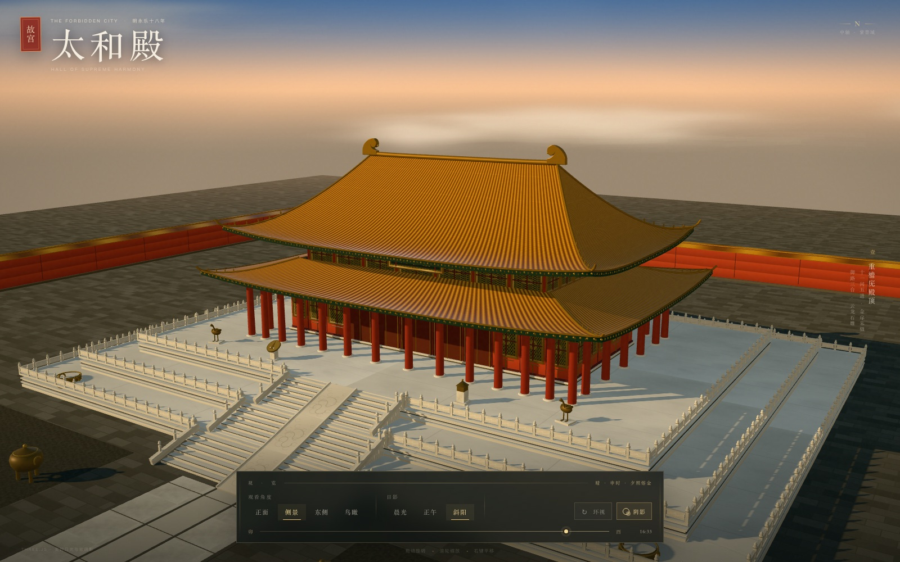

# 太和殿 · Taihe Hall

> Hall of Supreme Harmony · The Forbidden City

一个用 Three.js 实时渲染的紫禁城太和殿三维场景。建筑、屋顶、石阶、栏杆、门窗纹理均由程序化几何与 Canvas 纹理生成，不依赖外部模型或贴图。



 

## 观览方式

直接双击打开 `index.html` 即可。页面已包含打包后的 `app.js`，无需安装依赖，也不需要联网。

也可以在项目目录运行本地服务：

```bash
npm run serve
# 打开 http://localhost:5173
```

## 场景能力

- **重檐庑殿顶**：程序化曲面屋顶、起翘翼角、正脊、垂脊、脊兽、瓦当与檐下斗拱。
- **太和殿主体**：十一间五进立面、朱红廊柱、金扉槛窗、太和殿匾额，以及上层披檐、额枋与彩画。
- **三台与丹陛**：三层汉白玉须弥座、望柱栏板、龙纹御路石阶，以及日晷、嘉量、铜鹤、铜鼎、铜缸等陈设。
- **实时日光**：时辰滑杆从晨到暮连续改变太阳方位、高度、光色、天空渐变和雾色；晨光、正午、斜阳可一键切换。
- **软阴影**：方向光实时阴影，可随时开启或关闭；桌面端使用 4096 阴影贴图，移动端使用 2048。
- **自由视角**：拖动旋转、滚轮缩放、右键平移；提供正面、侧景、东侧、鸟瞰四个机位，可自动环视。
- **响应式构图**：竖屏设备会自动调整相机距离和视场角，并采用更紧凑的控制台布局。

## 开发

```bash
npm install
npm run build     # 重新生成 app.js
npm run watch     # 开发时监听构建
```

源码位于 `src/`：

- `main.js`：渲染器、相机、灯光、交互与动画
- `hall.js`：三台、殿身、立面、台阶、陈设与院落
- `roof.js`：双檐曲面屋顶与屋脊几何
- `sky.js`：天空穹顶、云层、雾与日光状态
- `textures.js`：所有程序化纹理
- `materials.js`：PBR 材质
- `styles.css` / `index.html`：界面与版式

> 建议使用支持 WebGL 2 的 Chrome、Edge 或 Safari 浏览。启用硬件加速可获得更流畅的阴影和抗锯齿效果。

## 提示词

> 写一个页面, 用three.js 实现太和殿, 要能控制观看角度要有关照和阴影
